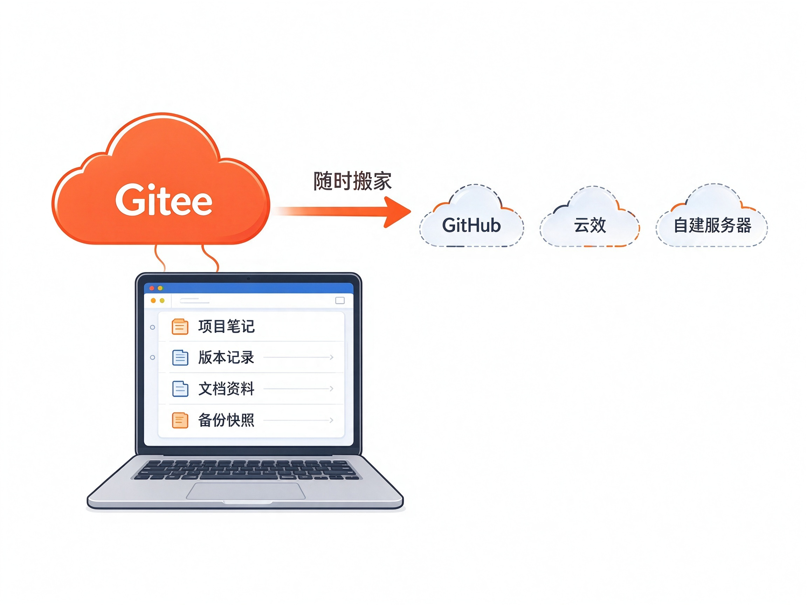
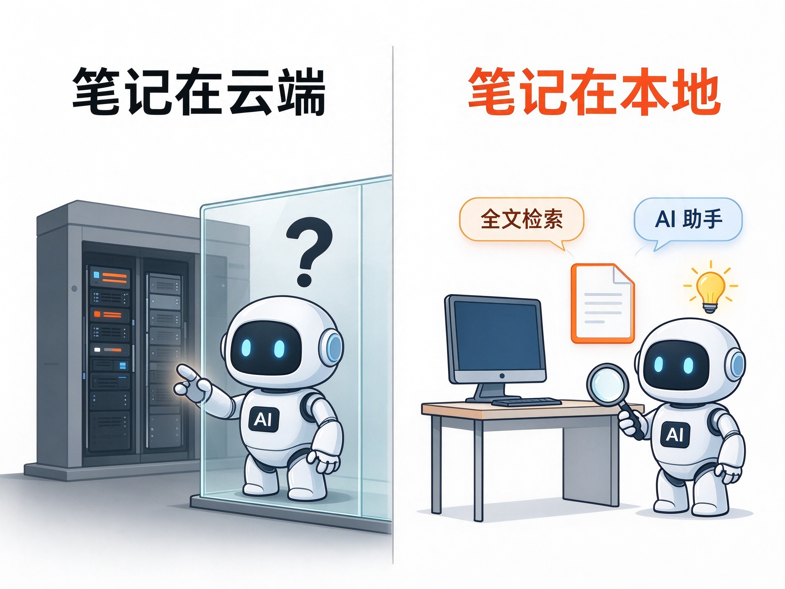
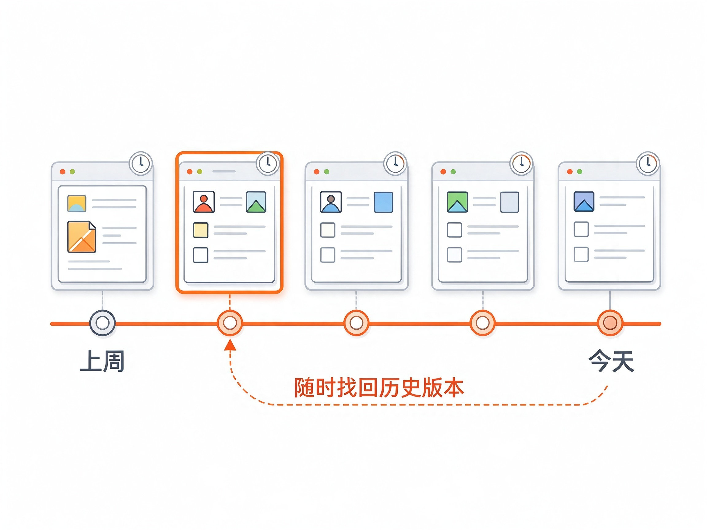
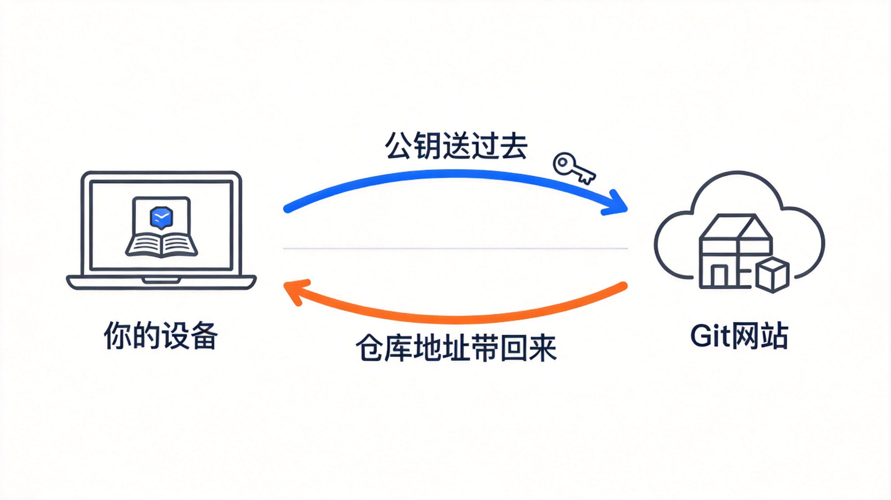

# Git笔记 帮助文档


> **"AI 时代，数据的掌控权必须留在本地，不被任何一家 SaaS 供应商绑定。"**

---

## Git笔记是什么

Git笔记是一款**本地优先**的微笔记应用：像发朋友圈一样随手记，数据却完全由你自己掌控——笔记以普通 Markdown 文件存在你电脑上，用 git 管理，可绑定任意远端 git 仓库进行多端同步。

- **仅本机模式**：一个 `git init` 就开始用，零配置零依赖（只需 git），数据只在本机。
- **绑定远端模式**：连接任意 git 服务器（SSH / HTTPS / 本地路径均可），自动同步，多设备共用一份笔记。

支持 Windows（Web 版 / Windows 桌面版）以及 Android（安卓 APK）。Web 版目前仅用于测试，macOS / Linux 暂不支持。

## 核心特点

**数据留在本地，通过远端 git 库同步，不被任何一家 SaaS 供应商绑定。**

- 你的笔记就是你电脑里的一个文件夹（`~/.git-notes/repo`），随时可以打开、复制、备份，即使卸载软件也不丢。
- 同步走的是标准 git 协议，不依赖任何私有云接口。服务随时可以换、可以停，你的数据照常可用。

## 三大特色

### 1. 存储自由，随时搬家



远端仓库可以自建，也可以放到 GitHub、Gitee、阿里云云效等 git 服务商——这些服务的基础功能都是**免费**的。今天放 Gitee，明天想换 GitHub？改一下仓库地址就行，笔记一条不丢。没有任何一家能锁住你。

### 2. 数据在本地，AI 更友好



数据锁在别人的云端，AI 想帮你检索、整理、总结都够不着。数据放在本地，AI 可以直接读取你的全部笔记——Git笔记内置 AI 助手，能帮你搜索、写笔记、批量整理、追溯历史，因为你的数据就在它手边。

### 3. 天然保留所有历史，随时追溯



用 git 管理，意味着每一次修改、删除都有记录。写错了一段话？误删了一篇笔记？随时可以翻回去找回任何时间点的任何版本。这是普通笔记应用做不到的。

---

## 功能详解

### 📝 发布与编辑

- **随手发**：输入框写完直接发，支持 **Ctrl+Enter** 快捷发布；自动记录发布时间，按「朋友圈」信息流倒序展示，每天一条日期分隔。
- **配图**：每帖最多 9 张图，直接粘贴截图即可上传；点开全屏灯箱浏览，右键可「复制图片 / 保存图片」。
- **附件**：除图片外还可挂任意附件（文档、压缩包、音频……单个 ≤10MB，每帖 ≤9 个），原始文件名保留。
- **编辑**：随时修改正文、换标签、增删图片和附件，保存即入 git 历史。
- **长文自动折叠**：超过 10 行的笔记自动收起，点击展开/收起，信息流不被刷屏。
- **字号调节**：设置页滑动条实时调整正文字号（10–50px）。
- **双主题**：浅色 / 深色 / 跟随系统，一键切换。

### 🏷 标签与整理

- **标签**：每帖可打多个标签，发布时点选或自定义新标签。
- **筛选**：点标签 chip 一键筛选该标签下的全部笔记。
- **钉住**：重要笔记可置顶钉住（最多 9 篇），钉住清单随同步走，所有设备一致。

### 🔍 全库搜索

- 毫秒级搜索本地仓库全部笔记，多个关键词 AND 组合，命中内容**高亮**显示。
- **支持拼音与首字母**：输入 `biji` 或 `bj` 都能命中「笔记」，内置 8105 常用字拼音表，不用切换输入法。

### 🔄 多端同步



- **自动同步**：每次写操作（发布/编辑/删除）自动完成「拉取远端 → 本地写入 → 单条 git 提交 → 推送」，push 被拒自动整合重试。
- **整合策略**：优先 rebase（保持历史线性），不行再 merge；都解决不了才进入「冲突待处理」，由你决定，可选**「强制推送（本地为准）」**一键覆盖（有二次确认）。
- **合并预览**：绑定时若远端已有笔记，会先展示双方提交数预览，确认后才合并，不会悄悄动你的数据。
- **随时解绑**：解绑回到仅本机模式，本地与远端数据都不删。

### 🤖 AI 助手

- 内置 AI 助手页，配置你自己的大模型 API Key（存于笔记仓库设置中，多端共享配置）。
- AI 能做的事：**搜索/筛选/阅读笔记、批量创建/修改/删除、按标签整理、查询 git 历史、找回旧版本笔记**等 20+ 种工具操作。
- **三级权限**：只读 / 每次确认 / 自动执行，可按需切换；批量删除超过 5 篇时无论什么模式都强制人工确认。
- AI 的写操作全部带审计标记进 git 历史，改了什么、什么时候改的，查得到。

### 🔐 安全

- 服务只监听本机 `127.0.0.1`，不暴露局域网与公网；页面凭证使用随机 cookie + Host 校验。
- SSH 连接使用**专用密钥**（自动生成 ed25519，不复用你的 `~/.ssh`），私钥权限 0600；支持密钥导入导出换机。
- 写入路径白名单严格限定在笔记目录内，删除操作以 git 提交落地——一切皆可追溯。

### 📦 数据格式（零锁定）

```
~/.git-notes/repo/
├── micro/2026/10/20261028-120000.md   ← 每帖一个 Markdown 文件（含标签/图片/附件信息）
└── settings/main.json                 ← 标签、钉住、AI 配置等统一设置
```

任何编辑器、任何 git 工具都能直接读写，永远不会被格式锁死。

---

## 快速上手

### 第一步：安装

| 版本 | 平台 | 获取方式 |
|---|---|---|
| Web 版 | Windows（当前仅用于测试；需 Node.js ≥18 和 git） | `cd web && npm i -g .`，命令行运行 `git-notes` |
| 桌面版 | Windows | 运行安装包 `git-notes-x.x.x-setup.exe` |
| 安卓版 | Android | 安装 APK |

### 第二步：选择模式

首次启动会出现引导页，二选一：

- **仅本机使用**：什么都不用配，直接开始记。数据只存在本机，零依赖。
- **绑定远端**：需要在多个设备之间同步，或想要一份云端备份时选这个。

### 第三步：绑定远端（三步走）

1. **送公钥**：在设置页点「查看公钥」，把这串公钥粘贴到你 git 服务商（如 Gitee/GitHub）的 SSH 设置里。
2. **建仓库**：在 git 服务商网页上新建一个**空仓库**，复制它的 **SSH 地址**（形如 `git@gitee.com:you/notes.git`，⚠️ 不是 https 地址）。
3. **粘贴连接**：把 SSH 地址贴进 Git笔记的绑定向导，点连接。之后每台设备都做同样操作，笔记就自动同步了。

之后日常使用无需任何操作：打开即最新，发布自动同步。

## 常见问题

**Q：换电脑了，笔记怎么迁移？**
新设备安装 Git笔记 → 绑定同一个远端仓库 → 自动拉取全部笔记与历史。整个过程就是一次 git 克隆。

**Q：远端服务商可以换吗？**
可以。换个仓库地址重新绑定即可，数据是标准 git 仓库，原样带走。

**Q：笔记是什么格式？**
普通 Markdown 文件（按 `micro/年/月/日期-时间.md` 存放），任何编辑器都能打开，永远不会有格式锁死的问题。

**Q：不用远端会丢数据吗？**
不会。仅本机模式下数据就在你电脑里，配合 git 历史依然可以追溯和恢复。远端只是额外的备份与同步手段。

**Q：误删了笔记怎么办？**
每一步操作都是 git 提交，历史里都在。可在 AI 助手里让它查 git 历史并恢复旧版本，会者也能直接用 git 命令找回。

**Q：AI 功能需要联网吗？**
AI 对话需要联网调用大模型服务（需自行配置 API Key），但你的笔记数据始终留在本地，由本机代理按需读取。

**Q：多设备同时改会冲突吗？**
正常先后使用几乎不会冲突（自动 rebase 整合）。真冲突时会明确提示「冲突待处理」，由你选择以本地为准强制推送，不会静默丢数据。
