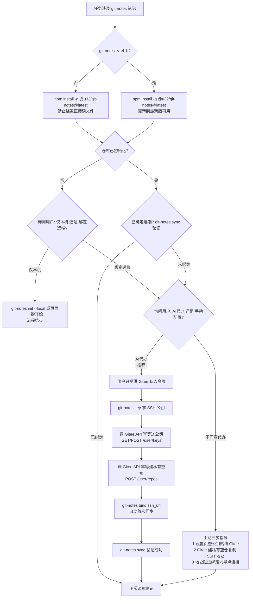

# Git笔记（git-notes）

## ⛔ 硬性规则：一切读写必须走 git-notes CLI，禁止直接碰文件

只要任务涉及用户的 git-notes 笔记（读、写、搜、改、删、统计，任何一种），**第一步**就是确认 `git-notes -v` 可用：不可用就先安装、可用也先用 `npm install -g @u32/git-notes@latest` 更新到最新版（同一条命令兼顾安装与更新），然后继续用 CLI。

- ❌ **禁止** `cat` / `grep` / `ls` / `find` ~/.git-notes/ 下的任何笔记文件，哪怕只是"查一下内容"
- ❌ **禁止**手工创建或编辑 `~/.git-notes/repo/micro/` 下的 `.md` 文件来记笔记或改笔记
- ❌ **禁止**因为"CLI 不存在/没安装"就放弃 CLI、改用直接读文件——唯一正确的做法是先安装 CLI
- ✅ **必须**所有读取都通过 `git-notes list / show / search` 等命令完成
- ✅ **必须**所有写入都通过 `git-notes add / edit / rm` 等命令完成

为什么不能直接碰文件（直接碰一定会出问题）：

1. **直接写文件不会触发 git 提交与远端同步**，笔记会"本机有、远端没有"，多设备间丢失；还会和 CLI 的写入相互冲突。
2. **CLI 的 id、搜索索引（含拼音）、front matter 解析都以命令输出为准**，手工猜路径、手工拼 front matter 极易出错。
3. **数据目录可能被 `GN_HOME` 环境变量重定向**，`~/.git-notes` 未必是真实数据位置。

## 产品是什么

Git笔记是**本地 git 仓库架构的微笔记信息流**（碎片化的微笔记、待办、备忘），核心理念："AI 时代，数据的掌控权必须留在本地，不被任何一家 SaaS 供应商绑定"。数据以 Markdown 形式存储（`micro/年/月/日期-时间.md`），经远端 git 仓库同步——**但 AI 一律通过 CLI 访问，不直接碰文件（见上方硬性规则）**。

- **开源**：MIT 协议，GitHub 仓库 <https://github.com/u32-cn/git-notes>
- **官网**：<https://git-notes.u32.cn/>
- **npm 包**：[`@u32/git-notes`](https://www.npmjs.com/package/@u32/git-notes)
- **三端**：PC Web（Node CLI/服务）、Windows 桌面版（Electron，官网可下载）、Android APK；三端同一套界面与数据格式，可多端同步
- **AI/skill 使用方式**：本 skill 通过 **npm 包（Web 版）的 CLI** 操控笔记——Windows 桌面版与 Android 版是给人用的 GUI，不含 CLI，AI 读写笔记必须安装 npm 包 `@u32/git-notes`（数据目录 `~/.git-notes` 三端共用）

### 特点

- **存储自由，零锁定**：数据在本地，远端可自建或放 GitHub / Gitee / 阿里云云效（均免费），换地址即搬家；仅本机模式也可用（零配置零依赖，只需 git）
- **AI 友好**：数据在本地，内置 AI 助手与外部 AI 工具（本 skill）可直接读写笔记：检索、批量整理、找回历史版本
- **全量历史，随时追溯**：每步操作都是 git 提交，误删可找回，任何版本可回看
- **全库搜索毫秒级**：支持拼音与首字母（如 `biji`/`bj` 命中「笔记」）
- **支持配图与任意附件**：每帖 ≤9 张图、≤9 个附件（单个 ≤10MB）；附件经界面一律以下载形式给出
- **安全**：服务只绑 127.0.0.1，SSH 同步用专用密钥（不复用 `~/.ssh`），写路径白名单仅 `micro/` 与 `settings/`

## 安装与更新

决策规则只有一条：`git-notes -v` 报错/命令不存在 → 执行下面的安装命令；已安装 → 执行同一条命令更新到最新版 → 再继续用 CLI。**唯一不允许的选项是放弃 CLI、改用直接读 `~/.git-notes/` 下的文件。** 不要因为安装麻烦就绕道，也不要直接放弃：

```bash
npm install -g @u32/git-notes@latest   # 依赖：Node ≥ 18、系统 PATH 有 git；安装/更新都是这条命令
```

安装完成后运行 `git-notes` 启动并完成首次初始化（见下方"注意事项"），之后即可正常读写。

## 桌面版与安卓版：AI 优先代办

用户想要 Windows 桌面版或安卓版时，**AI 先自己动手安装，装不了或用户点名要手动操作才给手动指导**。注意：这两端是给人用的 GUI，**不含 CLI**——AI 自己读写笔记仍必须用上面的 npm 包 CLI。数据目录 `~/.git-notes` 三端共用，装完首次启动即可与已有数据同步，无需重新初始化。

### Windows 桌面版（AI 代办，默认路径）

1. 拉更新源 `https://u32.cn/bd/apps/git-notes/update/win/latest.yml`，取最新版 exe 的下载地址与版本号
2. 下载 `git-notes-<版本>-setup.exe` 到临时目录（**不要放进任何 git 仓库**）
3. 静默安装：`git-notes-<版本>-setup.exe /S`（NSIS 静默参数），装完运行 `git-notes -v` 或启动应用验证
4. 第 1/2/3 步失败（下载失败、静默参数不被识别等）才退回手动指导：让用户从官网 <https://git-notes.u32.cn/> 下载安装包双击安装

### Android 版（能代办则代办）

1. 从官网 <https://git-notes.u32.cn/> 取 APK 下载地址，下载到本地临时目录
2. 手机已连电脑且开了 USB 调试 → `adb install -r <apk路径>` 直接安装
3. 无 adb 或未连设备 → 把 APK 下载到用户指定位置（或给出下载链接），请用户在手机上点开安装（此时才是手动）
4. 安装后首次启动完成初始化/绑定远端即可与已有数据同步

## 远端绑定：先问用户选模式，绑定则优先 AI 代办

Git笔记两种模式：**仅本机使用**（数据只在本机，零配置）与**绑定远端**（多设备同步 + 云端备份）。

**仓库尚未绑定远端时（首次初始化或 `git-notes sync` 提示未绑定），必须先询问用户选哪种模式，禁止替用户默认：**

- 选**仅本机使用** → 指导在初始化页点「仅本机使用」一键开始（或 `git-notes init --local`），流程结束。
- 选**绑定远端** → **优先推荐用户让 AI 代办**：用户只需提供一个 Gitee 私人令牌，其余全部由 AI 完成；用户明确不同意 AI 代办时，才退回三步手动指导。远端**优先推荐 Gitee**（国内访问快，免费私有仓）。

### 绑定全流程（mermaid 流程图，严格按此顺序执行）



### 绑定相关 CLI 命令

```bash
git-notes key                        # 输出 SSH 公钥（贴到 Gitee/GitHub 的 SSH 设置）
git-notes bind <远端地址> [--json]   # 绑定远端仓库（SSH/HTTPS/本地路径）并立即同步
git-notes unbind [--yes]             # 解绑回仅本机模式（本地与远端数据都不动）
```

### AI 代办配置步骤（用户同意代办后按此顺序）

AI 可代办除"提供 Gitee 私人令牌"外的全部步骤，按顺序：

1. `git-notes key` 拿到 SSH 公钥。
2. 向用户要 Gitee 私人令牌（Gitee → 设置 → 私人令牌，勾选 `projects` 与 `user_keys` 权限）。令牌属敏感信息，只在调用 API 时使用，不要写入任何文件或笔记。
3. 用令牌调 Gitee API 完成远端两步（都做幂等检查，避免重复报错）：
   - 送公钥：先 `GET https://gitee.com/api/v5/user/keys?access_token=<令牌>` 查是否已添加过（比对 key 内容），没有才 `POST .../user/keys`，参数 `key=<公钥>`、`title=git-notes`
   - 建私有空仓：`POST https://gitee.com/api/v5/user/repos`，参数 `name=git-notes`、`private=true`（不初始化 README）；返回 409/已存在则直接复用已有仓库
   - 从响应取 `ssh_url`（形如 `git@gitee.com:用户名/git-notes.git`）
4. `git-notes bind <ssh_url>` 完成绑定并自动首次同步；`git-notes sync` 再验证一次成功即完成。远端已有旧笔记时 bind/同步会走合并流程，如实向用户报告结果，出现冲突时给出 `force-push` / `reset-to-remote` 的取舍说明（都是破坏性操作，必须用户明确选择后才执行）。

用户不愿提供令牌时退回三步手动指导。GitHub 等其他服务商同理（`GET/POST https://api.github.com/user/keys`、`POST https://api.github.com/user/repos`）。

## 附件与图片：先压缩，再入库

添加附件或图片时，**先尽量压缩到尽可能小**——在保证图片字迹清晰可读的前提下压缩质量与分辨率，能小则小。git 仓库不适合存储大的附件和图片：历史永远保留，大文件会让仓库体积持续膨胀、同步变慢。限制：图片每帖 ≤9 张，附件单个 ≤10MB、每帖 ≤9 个；超过约 6M 的大文件建议存到网盘，笔记里只记一条备忘链接。

## 数据位置与查看方式

（以下仅供了解产品架构，**AI 查看笔记内容仍然只能用 CLI 命令，禁止据此直接读文件**）

- 数据目录：`~/.git-notes/`（本地仓库在 `~/.git-notes/repo/`，micro/YYYY/MM/ 按月存放，front matter 含 type/tags/created/images/files；可被 `GN_HOME` 重定向）
- 网页界面：`http://127.0.0.1:8644`（运行 `git-notes` 启动并自动打开；CLI 会自动拉起服务，无需手动启动）
- 命令行：`git-notes list / show / search` 等子命令直接查看（见下方命令速查）
- 环境变量：`GN_PORT` 换端口、`GN_HOME` 换数据目录（测试/多实例隔离）、`GN_NO_OPEN=1` 不自动开浏览器

## 命令速查

```bash
git-notes list [--limit N] [--tag 标签] [--json]   # 列出笔记（新→旧），id 见输出的 path 字段
git-notes add "<正文>" [--tag a,b] [--json]        # 新增笔记
git-notes edit <id> "<新正文>" [--tag a,b]         # 编辑；不指定 --tag 保留原标签
git-notes rm <id> [--yes]                          # 删除（非交互环境必须加 --yes）
git-notes pin <id> [--off]                         # 钉住 / 取消钉住
git-notes show <id>                                # 查看笔记原文（Markdown）
git-notes search "<关键词>" [--json]               # 全库搜索（支持拼音/首字母）
git-notes tags                                     # 列出全部标签
git-notes sync                                     # 手动同步（绑定了远端时）
git-notes log [--limit N] [--path <笔记路径>]      # 查看提交历史
git-notes doctor [目录]                            # 校验笔记文件合规性（只读）
git-notes status / stop / -v / help                # 服务管理
git-notes key                                      # 输出 SSH 公钥（远端绑定用）
git-notes bind <远端地址>                          # 绑定远端仓库并立即同步
git-notes unbind [--yes]                           # 解绑回仅本机模式
git-notes restore <id>                             # 列出该笔记的全部历史版本
git-notes restore <id> <commit> [--yes]            # 查看/恢复历史版本（默认预览，--yes 才恢复）
git-notes changes [--json]                         # 未提交改动清单（分支 + 变动文件）
git-notes remote [--json]                          # 远端状态（是否绑定/跟踪健康/领先落后）
git-notes diff [--stat] [--staged] [--from X --to Y] [--path <id>]   # 查看差异
git-notes force-push [--yes]                       # 强制推送（本地为准，覆盖远端，破坏性）
git-notes reset-to-remote [--yes]                  # 重置为远端版本（丢弃本地未推送，破坏性）
git-notes init --local                             # 初始化本地仓库（仅本机模式，无浏览器环境用）
git-notes init <远端地址>                          # 从远端仓库克隆初始化（多设备同步）
```

`<id>` = `list`/`search` 输出的 `path` 字段（如 `micro/2026/11/20261105-104144.md`），也可用裸文件名（`20261105-104144.md` 或 `20261105-104144`）。

## 用户问题 → 命令（先跑命令拿数据，再回答）

回答任何关于笔记内容的问题，**必须先跑对应命令取到真实数据**，禁止凭空回答或直接说"不知道"：

| 用户问 | 执行 |
|---|---|
| 当前/最近有哪些待办？ | `git-notes list --tag 待办` |
| 我记过 XX 吗 / 关于 XX 的笔记？ | `git-notes search "XX"` |
| 最近记了什么？ | `git-notes list --limit 20` |
| 某篇笔记的全文/完整内容？ | 先 `list`/`search` 拿到 path，再 `git-notes show <path>` |
| 我有哪些标签？ | `git-notes tags` |
| 这篇笔记的历史版本/改动记录？ | `git-notes log --path <path>` |
| 恢复这篇笔记的某个旧版本/误删找回？ | `git-notes restore <path>` 列版本 → `restore <path> <commit>` 预览 → 加 `--yes` 恢复 |

- 内置默认标签：`待办`、`已完成待办`、`备忘`、`日记`、`杂记`、`收藏`、`想法`、`感悟`（用户可能增删，以 `git-notes tags` 实际输出为准）。涉及"待办/任务/要做的事"优先按标签查，查不到再用 search 兜底。
- `list`/`search` 默认输出是摘要（正文前 120 字符），需要全文时用 `show`。

## 典型流程

记一条笔记：`git-notes add "内容要点" --tag 备忘`
查最近笔记：`git-notes list --limit 10`
找笔记再改：`git-notes search "关键词"` → 用命中的 `path` 作 id → `git-notes edit <id> "新正文"`

程序/AI 解析输出时加 `--json`（list/search/add/edit 输出原始 JSON）。

## 注意事项

- 首次使用需先运行 `git-notes` 打开页面完成初始化（引导页二选一：「仅本机使用」一键开始，或「从远端仓库克隆」多设备同步）；之后 CLI 才能读写
- 同步与冲突：写操作自动「先同步拉齐远端 → 本地写 → 单个 commit → push」，整合优先 rebase 其次 merge；仍冲突则进入「冲突待处理」，页面提供「强制推送（本地为准）」（覆盖远端，需二次确认）
- 分支定死 `main` 不可改；本地 main ↔ 远端 origin/main
- 直接改了仓库里的文件后，用 `git-notes doctor` 校验是否合规
- 同一秒内连续 add 会冲突，间隔 1 秒重试即可
- 卸载：`npm uninstall -g @u32/git-notes`（数据都在 `~/.git-notes`，卸载软件不影响数据）
